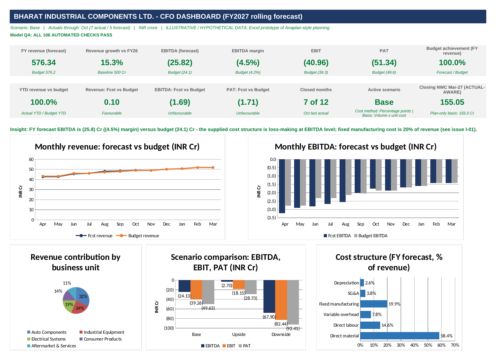
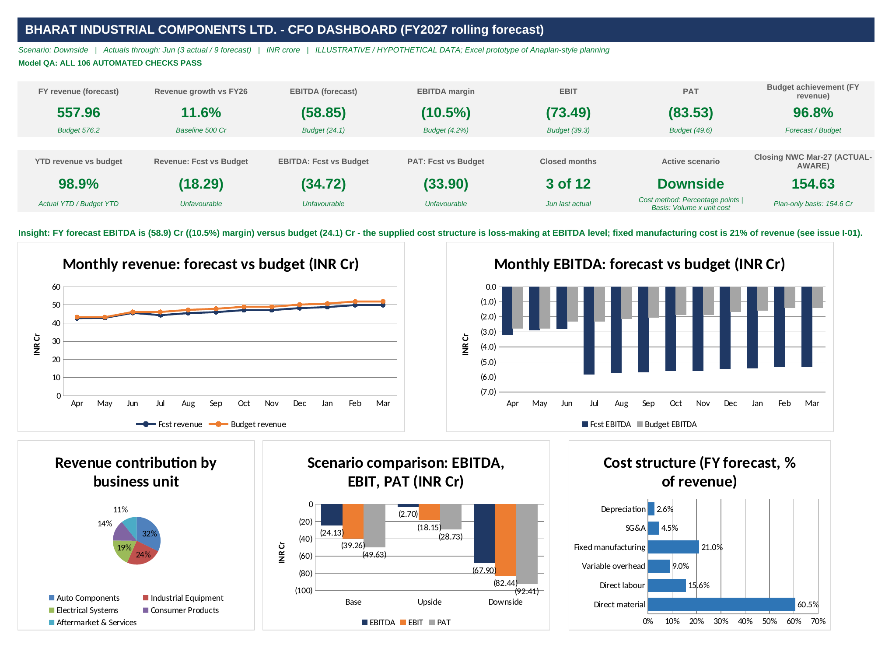
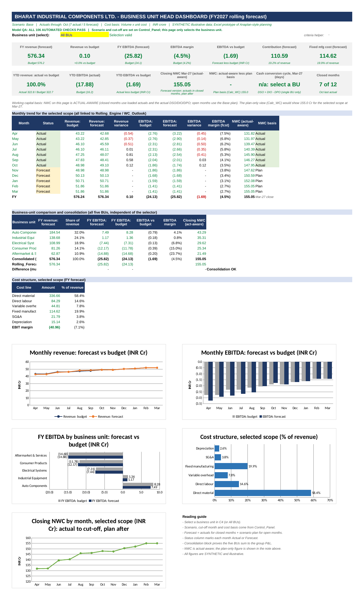
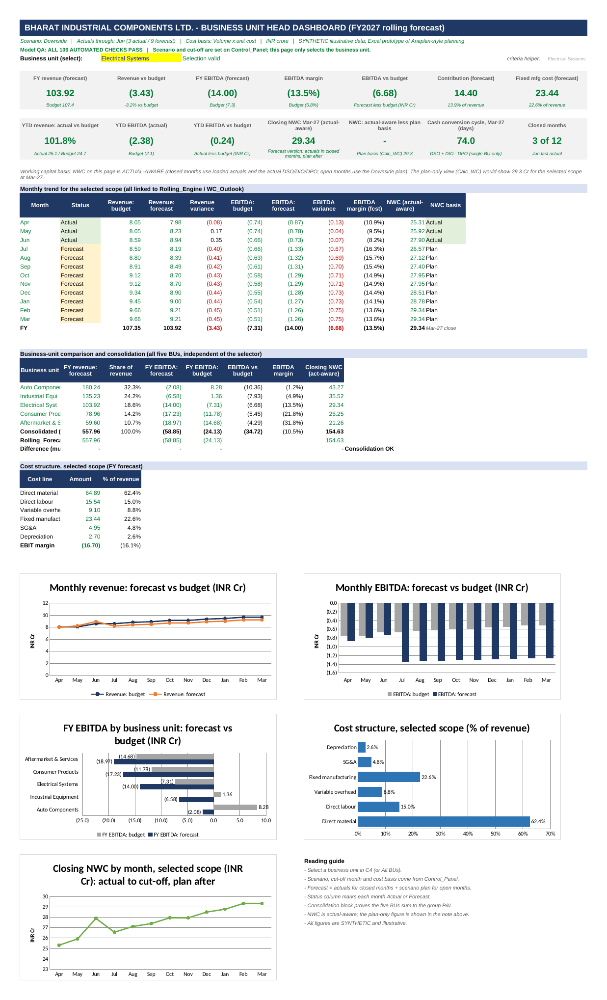
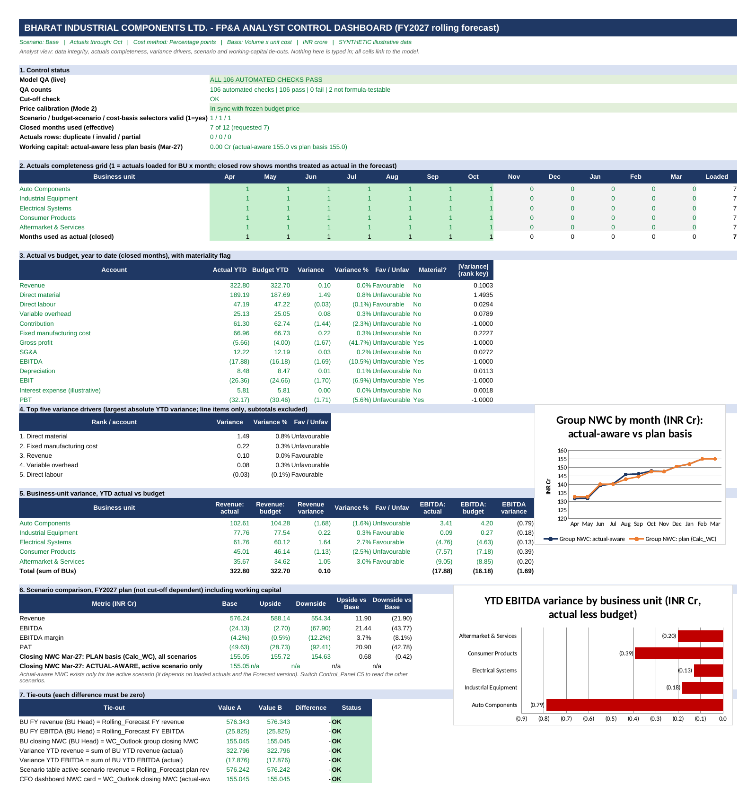
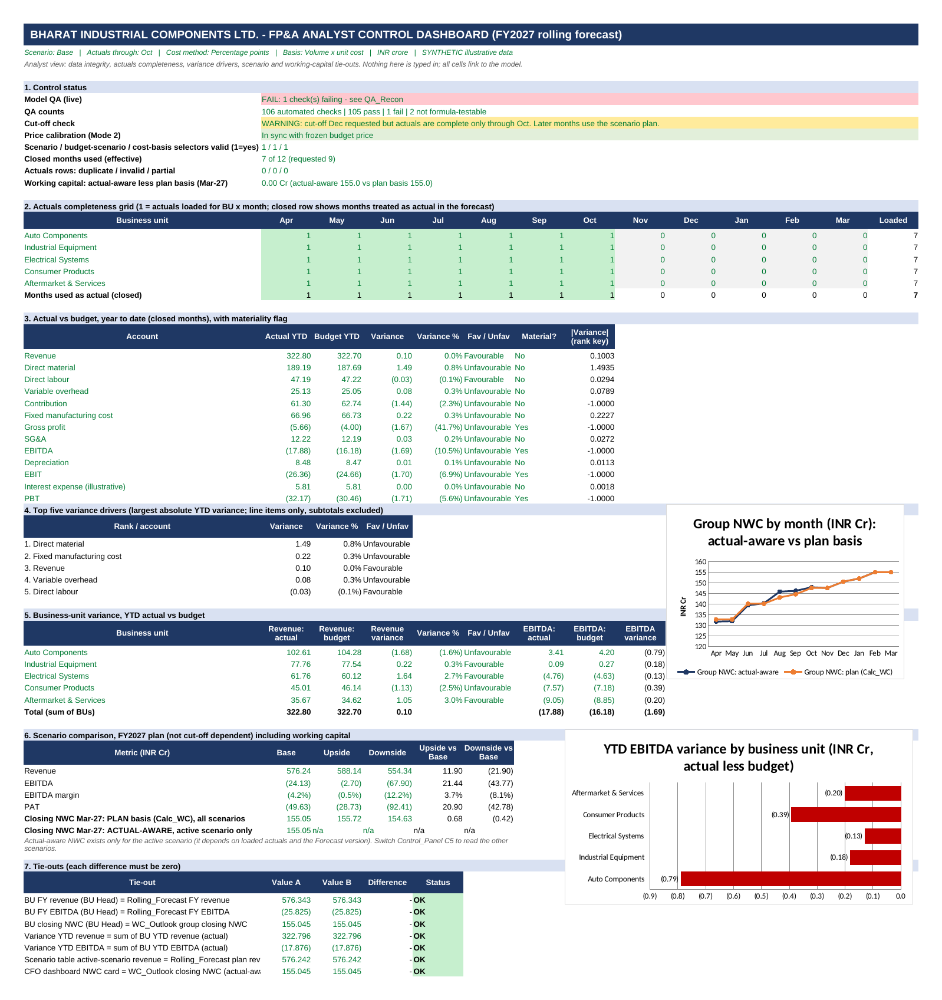

# Dashboard screenshots

Renders of the model v2.1 dashboards produced in **LibreOffice 24.2** from **synthetic, illustrative data** (fictional BICL). Microsoft Excel rendering has not been verified. Margins were cropped; nothing else was edited. Not affiliated with Deloitte or Anaplan.

### CFO dashboard: Base scenario, October cut-off (7 actual months, 5 forecast). Forecast revenue 576.34 and EBITDA (25.82) include synthetic actuals; budget is 576.24 and (24.13).

### CFO dashboard: Downside scenario, June cut-off.

### Business unit head dashboard: all business units, Base scenario, October cut-off.

### Business unit head dashboard: Electrical Systems, Downside scenario, June cut-off.

### FP&A analyst dashboard: Base scenario, October cut-off (controls, completeness, variances, tie-outs).

### FP&A analyst dashboard during a deliberate test: a December cut-off was requested although actuals exist only through October. The warning and the "1 check failing" status are intended behaviour, not a model fault.

